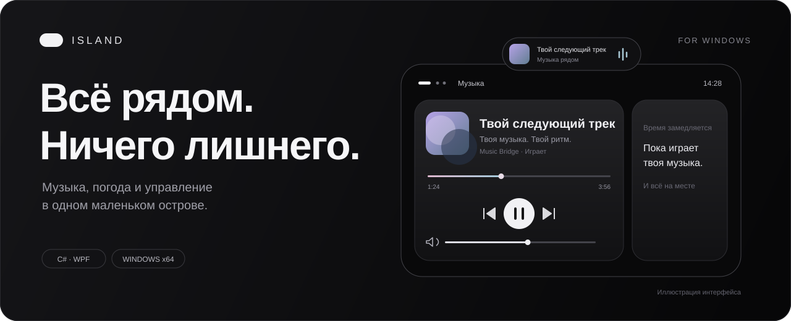

<p align="center">
  
</p>

<p align="center">
  <a href="https://github.com/wrx6666/island-windows/releases/latest"></a>
  
  
</p>

<p align="center">Музыка под рукой. Погода рядом. Рабочий стол свободен.</p>
<p align="center"><a href="https://github.com/wrx6666/island-windows/releases/latest">Скачать</a> · <a href="docs/INSTALLATION.md">Установка</a> · <a href="docs/RELEASING.md">Выпуск обновлений</a> · <a href="https://github.com/wrx6666/island-windows/issues">Обратная связь</a></p>

## Маленький остров. Всё нужное.

Island — компактная панель для Windows с музыкальным плеером, погодой и настройками внутри одного интерфейса. В обычном состоянии это маленькая иконка или музыкальная капсула; при наведении она плавно раскрывается.

| Музыка | Рабочий стол | Под твой ритм |
| --- | --- | --- |
| Яндекс Музыка и VK через Music Bridge | Иконка, компактная капсула и раскрытая панель | Плавные прерываемые переходы |
| Play / Pause, переключение и перемотка | Скрытие над полноэкранными приложениями | Палитра по обложке и аудиореактивный свет |
| Громкость музыкального источника | Перемещение и выбор монитора | Горячие клавиши, включая одиночные |
| Текст песни, когда он доступен | Погода и время | Отключение звука выбранного приложения |

Скрытая панель останавливает визуальную анимацию. Захват и анализ аудио работают отдельно от UI; возможности изолированного захвата зависят от версии Windows и музыкального источника. Отсутствие влияния на FPS игр не гарантируется: оно зависит от системы и выбранных эффектов.

## Начать за минуту

1. Открой [последний релиз](https://github.com/wrx6666/island-windows/releases/latest) и скачай **IslandSetup.exe**.
2. Запусти установщик. .NET уже включён; отдельно устанавливать его не нужно.
3. Для музыки в браузере один раз включи **Island Music Bridge** по [инструкции](docs/INSTALLATION.md#музыка-в-браузере).

Автозапуск меняется в **Настройки → Запуск**. Горячие клавиши назначаются в **Музыка и звук**. В публичной версии погодный источник по умолчанию — Москва; геолокация и поиск по IP не используются.

## Обновления без переустановки вручную

В **Настройки → Обновления** можно включить автоматическую проверку или проверить новую версию вручную. При обнаружении релиза Island показывает уведомление. Кнопка **«Загрузить и перезапустить»** скачивает обновление, проверяет целостность пакета и перезапускает приложение.

Настройки и бинды хранятся отдельно от устанавливаемых файлов. Проверка не запускает браузер; скачивание и перезапуск начинаются по нажатию пользователя. Черновики и предварительные релизы не предлагаются обычным установкам.

## Собрать из исходников

Нужны Windows x64, [.NET SDK](https://dotnet.microsoft.com/download) версии из `global.json` и PowerShell 7. Для тестов расширения также нужен Node.js.

```powershell
pwsh ./build-modern.ps1 -Test
pwsh ./build-installer.ps1 -Version 0.11.0 -GitHubRepository "https://github.com/wrx6666/island-windows"
```

Установщик и файлы обновления появятся в `release/modern`. Автоматическая сборка выполняется через GitHub Actions — [как выпустить новую версию](docs/RELEASING.md).

| Часть | Где находится |
| --- | --- |
| Панель и настройки WPF | `modern/DynamicIsland.UI` |
| Музыка, погода и аудиоанализ | `modern/DynamicIsland.Core` |
| Windows, окна, аудио и клавиши | `modern/DynamicIsland.Windows` |
| Связь с браузером и Native Host | `modern/DynamicIsland.BrowserIntegration`, `modern/DynamicIsland.BrowserHost` |
| Расширение | `browser-extension` |
| Сборка установщика и обновлений | `build-installer.ps1`, `.github/workflows/release.yml` |

## Данные и ограничения

Настройки установленного приложения сохраняются локально в `%LOCALAPPDATA%/Island/Data`. Music Bridge обменивается командами и метаданными через локальный Native Messaging; вход в музыкальный аккаунт выполняется в обычном браузере. Для погоды используются [Open-Meteo](https://open-meteo.com/), для текста песен — [LRCLIB](https://lrclib.net/).

Браузерное расширение включается пользователем. Island не обходит autoplay, авторизацию, античиты и ограничения Exclusive Fullscreen. Точный трек, очередь и позиция при восстановлении зависят от музыкального сервиса. Доступность текстов песен и управления отдельными функциями зависит от источника.

Сторонние лицензии включены в установщик; сведения о них — в [THIRD-PARTY-NOTICES](distribution/THIRD-PARTY-NOTICES.txt). Проект независимый и не связан с Apple, Яндексом или VK.
